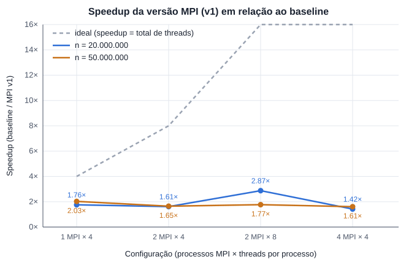
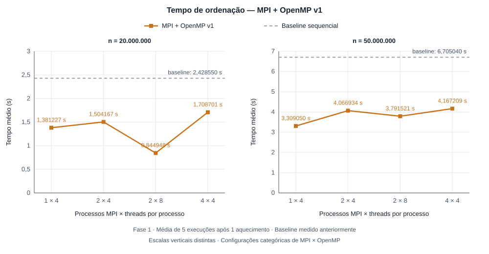
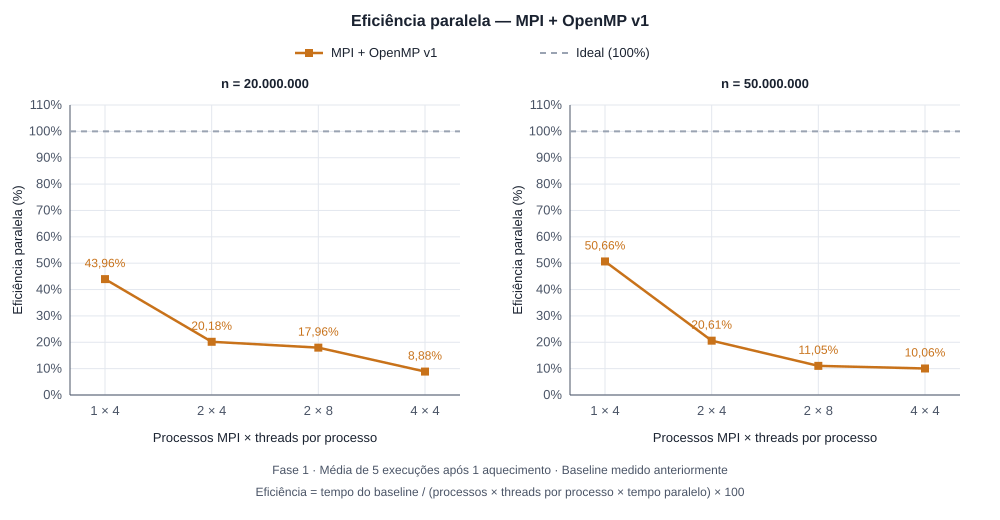

# MPI + OpenMP — Versão 1

## Qual a ideia

A ideia desta versão é paralelizar a recursão do Mergesort utilizando MPI e OpenMP, sem alterar o algoritmo de intercalação do baseline.

O MPI distribui partes do vetor entre processos diferentes, enquanto o OpenMP utiliza tarefas para ordenar as subdivisões dentro de cada processo. O merge continua sendo realizado sequencialmente, utilizando `baseline_merge`.

A implementação está dividida em dois arquivos:

- `mpi.cpp`: implementação paralela sem instrumentação.
- `mpiV1perfilamento.cpp`: implementação com medições de desempenho e perfilamento dos merges.

### Paralelização com MPI

A função `msort_mpi` recebe um trecho do vetor e a quantidade de processos disponíveis para ordená-lo.

Quando existe mais de um processo disponível, o trecho é dividido ao meio:

- A metade esquerda é enviada para outro processo MPI.
- A metade direita é ordenada pelo processo atual.
- O processo atual espera o resultado da metade esquerda.
- Depois que as duas metades estão ordenadas, realiza o merge utilizando `baseline_merge`.

A comunicação utiliza `MPI_Send`, `MPI_Isend`, `MPI_Recv` e `MPI_Wait`.

Os processos auxiliares recebem o trecho por meio da função `ajudante`, realizam a ordenação e devolvem o resultado ao processo que solicitou o trabalho.

Quando resta apenas um processo responsável pelo trecho, a ordenação passa a utilizar OpenMP.

### Paralelização com OpenMP

A função `msort_paralelo` segue a mesma ideia da versão OpenMP V1.

A metade esquerda é executada em uma tarefa criada com `#pragma omp task`, enquanto a metade direita é processada pela thread atual.

O `#pragma omp taskwait` garante que as duas metades estejam ordenadas antes de iniciar o merge.

Quando não há mais divisão de tarefas, a função utiliza `baseline_msort` para ordenar o trecho sequencialmente.

Também existe uma condição de parada para trechos vazios ou com apenas um elemento, evitando recursões desnecessárias.

### Memória utilizada

Cada processo MPI aloca os vetores completos `a` e `tmp`, mas trabalha apenas no trecho que recebeu.

Isso significa que o consumo de memória aumenta com a quantidade de processos:

| Tamanho do vetor | Memória aproximada de `a + tmp` por processo |
|---|---:|
| 20.000.000 | 152,6 MiB |
| 50.000.000 | 381,5 MiB |

No perfilamento, o processo principal também mantém um vetor de referência para verificar o resultado da ordenação.

## Condições de corrida

Como a implementação utiliza MPI e OpenMP, foi necessário considerar o acesso aos dados e a sincronização das tarefas.

### MPI

Cada processo MPI possui seu próprio espaço de memória. Por isso, os processos não acessam diretamente os vetores uns dos outros.

A comunicação acontece por mensagens, utilizando identificadores diferentes para o cabeçalho, os dados enviados e o resultado da ordenação.

O `MPI_Wait` garante que o envio não bloqueante seja concluído antes de continuar para a etapa de recebimento e merge.

O `MPI_Recv` garante que o processo atual receba a metade esquerda já ordenada antes de realizar a intercalação.

A inicialização utiliza `MPI_Init_thread` com `MPI_THREAD_FUNNELED`, pois as chamadas MPI são realizadas fora das regiões paralelas do OpenMP. A implementação também verifica se o nível de suporte solicitado foi disponibilizado.

### OpenMP

As tarefas trabalham em intervalos diferentes do vetor. Assim, enquanto uma thread ordena a metade esquerda, outra pode ordenar a metade direita.

O `#pragma omp taskwait` é utilizado antes do merge para impedir que a intercalação comece enquanto alguma das metades ainda está sendo modificada.

O merge é realizado por uma única thread após a conclusão das tarefas correspondentes.

### Critical na instrumentação

Na versão de perfilamento, diferentes threads podem registrar informações na mesma estrutura `niveis`.

Por isso, o `#pragma omp critical` protege a atualização das estatísticas de cada nível, evitando que duas threads modifiquem os mesmos dados simultaneamente.

Essa proteção é utilizada apenas na versão instrumentada e pode acrescentar custo à execução.

### Junção dos resultados entre processos

Cada processo registra localmente os tempos dos merges que executou.

Ao final do perfilamento, a função `juntar_niveis` utiliza operações coletivas MPI para reunir os resultados.

O `MPI_Reduce` soma os tempos de intercalação, cópia e as quantidades de merges. Para informações como o maior tempo individual, utiliza-se a operação de máximo.

Dessa forma, o processo principal consegue apresentar uma tabela única com as informações coletadas pelos diferentes processos.

## Medidas

### Protocolo de medição

Os testes foram executados utilizando Docker Compose, com compilação pelo `mpicxx` e execução pelo `mpirun`.

Foram utilizados os seguintes parâmetros:

| Parâmetro | Valor |
|---|---|
| Tamanhos dos vetores | 20.000.000 e 50.000.000 |
| Repetições medidas | 5 |
| Aquecimento | 1 execução |
| Corte do perfilamento | 2160 |
| Configurações | 1×4, 2×4, 2×8 e 4×4 |

Em cada execução, o programa realiza duas fases:

**Fase 1 — Tempo de execução**

Executa o Mergesort paralelo sem instrumentação detalhada, descarta o aquecimento e calcula a média das cinco repetições.

Esse é o tempo utilizado para calcular o speedup e a eficiência.

**Fase 2 — Perfilamento**

Executa a versão instrumentada e registra, para os merges com tamanho a partir do corte:

- Tempo gasto na intercalação (`sort`).
- Tempo gasto na cópia de volta (`copia`).
- Tempo total dessas operações.
- Quantidade de merges por nível.
- Maior duração individual registrada em cada nível.

Os tempos de `sort` e `copia` são acumulados entre threads e processos. Portanto, não devem ser interpretados como o tempo total de execução do programa.

O tempo de comunicação MPI também não é apresentado separadamente nessas colunas.

Ao final de cada fase, o vetor ordenado é comparado com o resultado do baseline, elemento por elemento.

### Tempos do baseline

Os tempos sequenciais utilizados como referência foram:

| Tamanho | Tempo do baseline |
|---|---:|
| 20.000.000 | 2,428550 s |
| 50.000.000 | 6,705040 s |

Esses valores foram obtidos anteriormente nos testes do baseline e utilizados como referência para o cálculo do speedup. A comparação pressupõe condições de execução equivalentes.

### Resultados — 20 milhões de elementos

| Processos MPI | Threads por processo | Tempo médio (s) | Speedup | Eficiência |
|---:|---:|---:|---:|---:|
| 1 | 4 | 1,381227 | 1,76× | 43,96% |
| 2 | 4 | 1,504167 | 1,61× | 20,18% |
| 2 | 8 | 0,844948 | 2,87× | 17,96% |
| 4 | 4 | 1,708701 | 1,42× | 8,88% |

A melhor configuração para 20 milhões de elementos foi **2 processos MPI com 8 threads cada**, apresentando tempo médio de 0,844948 segundo e speedup de aproximadamente 2,87×.

Entretanto, a configuração de 4 processos com 4 threads foi mais lenta, apesar de utilizar o mesmo total de 16 threads.

Isso indica que a distribuição entre processos pode influenciar o desempenho, já que a execução também envolve comunicação e sincronização MPI.

### Resultados — 50 milhões de elementos

| Processos MPI | Threads por processo | Tempo médio (s) | Speedup | Eficiência |
|---:|---:|---:|---:|---:|
| 1 | 4 | 3,309050 | 2,03× | 50,66% |
| 2 | 4 | 4,066934 | 1,65× | 20,61% |
| 2 | 8 | 3,791521 | 1,77× | 11,05% |
| 4 | 4 | 4,167209 | 1,61× | 10,06% |

Para 50 milhões de elementos, a melhor configuração entre as testadas foi **1 processo MPI com 4 threads OpenMP**, com tempo médio de 3,309050 segundos e speedup de aproximadamente 2,03×.

As configurações com mais processos MPI apresentaram tempos maiores. Uma explicação possível é que os custos de comunicação, sincronização e concorrência pelos recursos do sistema tenham reduzido os ganhos obtidos com a distribuição do trabalho.

Como esses custos não foram medidos isoladamente, não é possível determinar quanto cada fator contribuiu para os resultados.

### Cálculo do speedup e da eficiência

O speedup representa a aceleração da implementação paralela em relação ao baseline sequencial:

\[
S = \frac{T_{\text{baseline}}}{T_{\text{paralelo}}}
\]

A eficiência relaciona o speedup ao número total de threads configuradas:

\[
E = \frac{S}{P \times T} \times 100
\]

Onde:

- \(P\) representa a quantidade de processos MPI.
- \(T\) representa a quantidade de threads OpenMP por processo.

A eficiência considera o total de threads configuradas, sem garantir que todas estejam executando trabalho útil simultaneamente.

### Gráfico de speedup

O gráfico apresenta a comparação entre as quatro configurações testadas, utilizando os tamanhos de 20 e 50 milhões de elementos.

Os resultados mostram que o speedup não aumenta necessariamente com a quantidade de processos e threads.

Para 20 milhões de elementos, a configuração 2 MPI × 8 threads apresentou o maior speedup. Para 50 milhões, o melhor resultado foi obtido com 1 MPI × 4 threads.

### Gráficos de tempo e eficiência

O eixo horizontal identifica processos MPI × threads OpenMP por processo.
As configurações são categorias: 2 × 8 e 4 × 4 usam 16 threads configuradas,
mas distribuem o trabalho entre processos de formas diferentes. As linhas apenas
conectam as configurações medidas.

O gráfico de tempo usa escalas verticais distintas; o de eficiência usa a mesma
escala nos dois painéis. Os valores vêm da Fase 1, com cinco repetições após um
aquecimento. A eficiência utiliza o baseline histórico e o total P × T, sem
arredondamento intermediário do speedup. A comparação com os gráficos OpenMP
pressupõe condições equivalentes, considerando que estes usam dez repetições
e dois aquecimentos. Não há barras de erro, pois só estão disponíveis as médias.

### Resultados do perfilamento

A tabela abaixo apresenta um resumo das medições da Fase 2.

| Tamanho | MPI × threads | Tempo instrumentado (s) | Sort acumulado (s) | Cópia acumulada (s) | Custo da instrumentação |
|---|---|---:|---:|---:|---:|
| 20 milhões | 1 × 4 | 1,317835 | 2,186282 | 0,178601 | −4,6% |
| 20 milhões | 2 × 4 | 1,499584 | 2,257354 | 0,178884 | −0,3% |
| 20 milhões | 2 × 8 | 1,341557 | 2,822334 | 0,241792 | +58,8% |
| 20 milhões | 4 × 4 | 1,616207 | 3,022654 | 0,251947 | −5,4% |
| 50 milhões | 1 × 4 | 3,405757 | 5,939850 | 0,507715 | +2,9% |
| 50 milhões | 2 × 4 | 3,967493 | 6,322963 | 0,521992 | −2,4% |
| 50 milhões | 2 × 8 | 3,246807 | 7,608706 | 0,702167 | −14,4% |
| 50 milhões | 4 × 4 | 4,143136 | 8,340590 | 0,719233 | −0,6% |

Em todas as configurações, a intercalação representou aproximadamente 92% do tempo acumulado dos merges grandes, enquanto a cópia de volta representou aproximadamente 8%.

Isso mostra que a maior parte do trabalho medido dentro dos merges está concentrada na intercalação.

Também foram observados custos de instrumentação negativos em algumas configurações. Isso ocorre quando a Fase 2 apresenta tempo menor que a Fase 1 e pode estar relacionado à variação entre execuções, ao escalonamento das threads e ao comportamento da memória.

O maior custo observado foi de **+58,8%**, na configuração de 2 MPI × 8 threads com 20 milhões de elementos. Isso indica que a instrumentação pode afetar significativamente o desempenho e reforça a necessidade de utilizar a Fase 1 para comparar os tempos de ordenação.

### Validação dos resultados

Todas as oito configurações testadas apresentaram:

- `igual ao baseline=SIM` na Fase 1.
- `igual ao baseline=SIM` na Fase 2.

Portanto, nos testes realizados, a implementação MPI + OpenMP V1 produziu o mesmo vetor ordenado que a implementação sequencial.

### Conclusão

A implementação MPI + OpenMP V1 conseguiu paralelizar a recursão do Mergesort, distribuindo partes do vetor entre processos MPI e utilizando tarefas OpenMP dentro de cada processo.

Os testes demonstraram que a versão paralela foi mais rápida que o baseline sequencial em todas as configurações medidas.

Entretanto, o aumento da quantidade de processos e threads não resultou em melhora contínua de desempenho.

Um dos fatores que pode limitar a escalabilidade é a utilização do `baseline_merge`, que permanece sequencial. Além disso, a distribuição entre processos MPI introduz comunicação e sincronização.

Os resultados sugerem que a escolha da configuração de processos e threads influencia significativamente o desempenho e que o merge sequencial continua sendo um ponto importante para investigar nas próximas versões.

Como foram realizadas cinco repetições medidas por configuração, seria interessante repetir os experimentos em condições controladas para verificar a estabilidade das diferenças observadas.