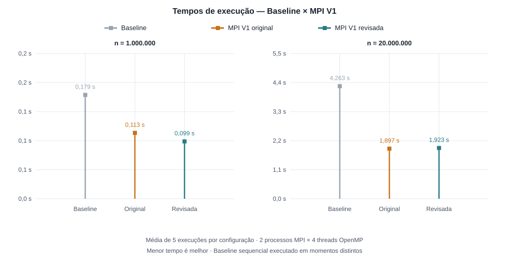
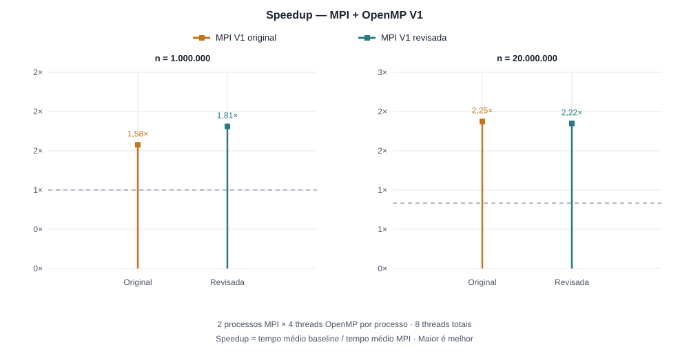
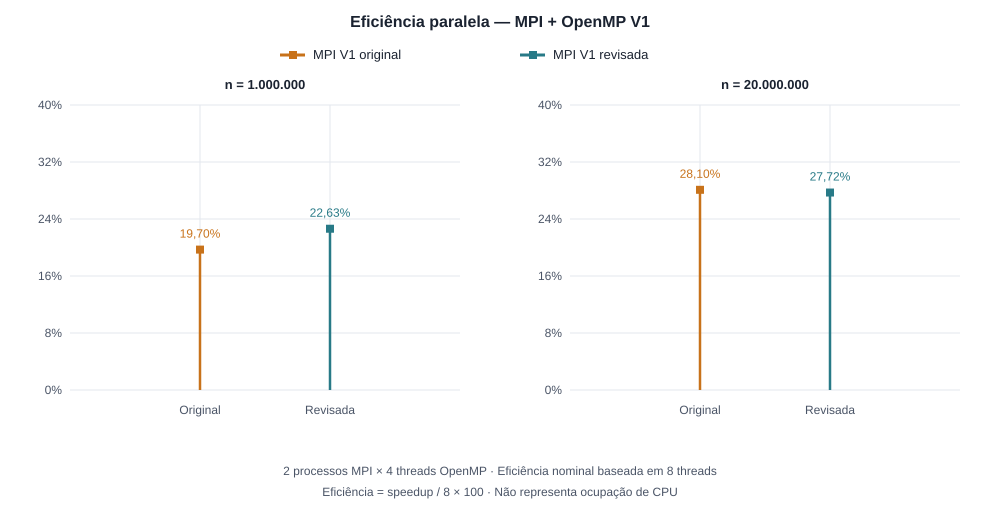
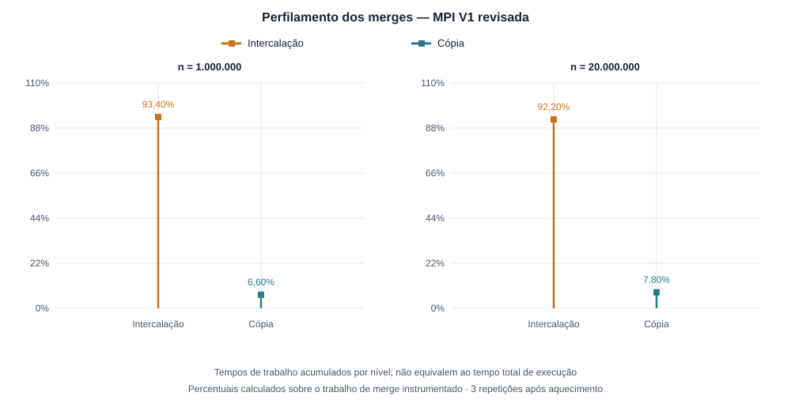

# MPI V1 revisada — Mergesort com MPI + OpenMP

**Disciplina:** Programação Paralela — Baseline 07 (Mergesort)  
**Instituição:** IESB — CCO085 — 2026/2  
**Professor:** Rodrigo Gonçalves Pinto  
**Implementação:** MPI V1 revisada (`mpi.cpp`) e perfilamento (`mpiV1perfilamento.cpp`)

## 1. Objetivo

Documentar a revisão da implementação MPI V1 do Mergesort, preservando sua estratégia original: distribuição recursiva de partes do vetor entre processos MPI, ordenação local com tarefas OpenMP e intercalação (`merge`) sequencial do baseline. A revisão priorizou clareza, validação de entradas e diagnóstico de desempenho, sem propor uma nova estratégia de ordenação.

A versão original permanece disponível em `MPI/v1/` para comparação, enquanto a revisada está em `MPI/v1revisado/`.

## 2. Alterações realizadas

### 2.1. Organização e legibilidade

- Substituição de identificadores abreviados por nomes mais descritivos, como `ordenar_com_openmp`, `ordenar_com_mpi`, `executar_processo_auxiliar`, `vetor`, `auxiliar`, `inicio`, `fim` e `quantidade_threads`.
- Separação mais clara das responsabilidades de ordenação local, distribuição MPI e processo auxiliar.
- Uso explícito de variáveis para o orçamento de paralelismo e os limites dos trechos.

### 2.2. Validação de parâmetros

- Leitura mais rigorosa de argumentos inteiros com `strtol`, verificando texto inválido e valores fora da faixa de `int`.
- Rejeição de tamanhos inválidos e de configurações com mais processos MPI que elementos no vetor.
- No perfilador, validação de repetições, aquecimento e corte, inclusive evitando transbordamento na soma das repetições com os aquecimentos.
- Verificação do suporte a `MPI_THREAD_FUNNELED`.

### 2.3. Controle das tarefas OpenMP

A versão revisada introduziu o limiar fixo `LIMIAR_TAREFA_OPENMP = 2160`. A recursão OpenMP passa a executar o Mergesort do baseline quando o orçamento de paralelismo é insuficiente ou o trecho tem menos de 2160 elementos.

**Observação:** nas configurações avaliadas (2 processos MPI × 4 threads OpenMP; vetores de 1 milhão e 20 milhões), esse limiar não altera materialmente a árvore de tarefas: o orçamento de paralelismo chega ao fim antes de os trechos atingirem esse tamanho. Portanto, não é possível atribuir eventuais diferenças de tempo ao limiar.

### 2.4. Perfilamento ampliado

A versão revisada mantém duas fases:

- **Fase 1:** tempo de parede da ordenação, sem instrumentação interna; valida todas as repetições medidas contra o resultado do baseline.
- **Fase 2:** tempos de intercalação e cópia por nível, além de diagnóstico de operações MPI e ordenação local OpenMP.

Foram acrescentadas medições de envio e recebimento de cabeçalhos/dados, espera em `MPI_Wait`, espera por resultados em `MPI_Recv`, envio de resultados, merge nos nós MPI e ordenação local. Os tempos são agregados por soma e máximo entre ranks.

**Cuidado de interpretação:** uma chamada bloqueante `MPI_Recv` inclui espera pelo processamento ou envio remoto; seu tempo não equivale ao custo puro de transferência. Tempos de ranks e threads podem se sobrepor e não devem ser somados para obter o tempo de parede.

## 3. Ambiente e metodologia

Os testes foram executados por meio de Docker Compose, com compilação C++ usando `mpicxx -O2 -fopenmp`. As configurações de MPI foram:

| Parâmetro | Valor |
|---|---:|
| Processos MPI | 2 |
| Threads OpenMP por processo | 4 |
| Total nominal de threads OpenMP | 8 |
| Tamanhos de entrada | 1.000.000 e 20.000.000 |
| Corte de perfilamento | 2160 |
| Perfilamento | 3 repetições medidas + 1 aquecimento |

Os resultados de **execução normal MPI** abaixo correspondem às médias de cinco execuções por versão e tamanho. O **baseline sequencial** também foi executado cinco vezes para cada tamanho. Os perfiladores foram executados separadamente, sem concorrência intencional entre os testes.

O baseline e as versões MPI foram medidos em momentos diferentes, e houve variação entre execuções; os resultados devem ser interpretados como medições experimentais, não como garantias de aceleração.

## 4. Tempos do baseline sequencial

Todas as execuções retornaram `ordenado=SIM`.

| Execução | 1.000.000 (s) | 20.000.000 (s) |
|---|---:|---:|
| 1 | 0,160877 | 3,414300 |
| 2 | 0,179461 | 4,327972 |
| 3 | 0,187877 | 4,363212 |
| 4 | 0,187658 | 4,343993 |
| 5 | 0,177574 | 4,865669 |
| **Média** | **0,178689** | **4,263029** |

A dispersão dos tempos, especialmente para 20 milhões de elementos, recomenda cautela na interpretação de diferenças pequenas entre versões.

## 5. Comparação da execução normal MPI

Todas as ordenações medidas retornaram `ordenado=SIM`.

| Elementos | Baseline sequencial (s) | MPI V1 original (s) | MPI V1 revisada (s) |
|---|---:|---:|---:|
| 1.000.000 | 0,178689 | 0,113353 | 0,098684 |
| 20.000.000 | 4,263029 | 1,896610 | 1,922683 |

### 5.1. Comparação visual dos tempos



A diferença relativa de tempo da revisão foi calculada por:

`Diferença (%) = (T_revisada / T_original - 1) × 100`

| Elementos | Diferença da revisada frente à original | Interpretação |
|---|---:|---|
| 1.000.000 | -12,94% | Menor tempo médio na revisada |
| 20.000.000 | +1,37% | Maior tempo médio na revisada |

Para 20 milhões de elementos, a diferença foi pequena diante da variabilidade observada em testes anteriores. Não há evidência suficiente de uma melhoria consistente de velocidade causada pela revisão.

## 6. Speedup e eficiência

O speedup em relação ao baseline sequencial é definido por:

`S = T_sequencial / T_paralelo`

Para a eficiência, adotou-se **p = 8**, correspondente a 2 processos MPI × 4 threads OpenMP por processo:

`E = (S / 8) × 100%`

Essa é uma eficiência nominal baseada no total de threads OpenMP configuradas, e não uma medida de utilização efetiva de núcleos físicos.

| Elementos | Speedup MPI V1 original | Speedup MPI V1 revisada | Eficiência MPI V1 revisada |
|---|---:|---:|---:|
| 1.000.000 | 1,58× | **1,81×** | **22,63%** |
| 20.000.000 | 2,25× | **2,22×** | **27,72%** |

### 6.1. Comparação visual do speedup



### 6.2. Comparação visual da eficiência paralela



Exemplo para 20 milhões de elementos:

`S = 4,2630292 / 1,922683 ≈ 2,2172 ≈ 2,22×`

`E = (2,2172 / 8) × 100 ≈ 27,72%`

As duas versões MPI apresentaram aceleração em relação ao baseline sequencial nas condições testadas. O speedup da revisada foi maior para a entrada de 20 milhões, embora o ganho não tenha sido proporcional ao total nominal de threads.

## 7. Resultados do perfilamento

Os tempos desta seção são de **execuções instrumentadas independentes** e não devem substituir os tempos de execução normal usados no cálculo de speedup.

### 7.1. Fase 1 e Fase 2

| Elementos | Versão | Fase 1 (s) | Fase 2 (s) | Igual ao baseline |
|---|---|---:|---:|---|
| 1.000.000 | Original | 0,102791 | 0,101555 | SIM |
| 1.000.000 | Revisada | 0,098009 | 0,097644 | SIM |
| 20.000.000 | Original | 2,277201 | 2,315241 | SIM |
| 20.000.000 | Revisada | 2,491834 | 2,201395 | SIM |

#### Distribuição do trabalho nos merges



Na entrada de 20 milhões, a Fase 2 revisada foi 11,7% mais rápida que sua própria Fase 1. Isso **não significa** que a instrumentação acelere o programa: as fases ocorreram em momentos diferentes e estão sujeitas à variabilidade do ambiente.

### 7.2. Trabalho medido nos merges

Os valores representam **somas de trabalho** de threads e processos, não tempo total de parede.

| Elementos | Versão | Intercalação (s) | Cópia (s) | Total dos merges (s) | Parcela da intercalação |
|---|---|---:|---:|---:|---:|
| 1.000.000 | Original | 0,103822 | 0,008179 | 0,112001 | 92,7% |
| 1.000.000 | Revisada | 0,103049 | 0,007230 | 0,110279 | 93,4% |
| 20.000.000 | Original | 3,365978 | 0,310577 | 3,676555 | 91,6% |
| 20.000.000 | Revisada | 3,317940 | 0,282587 | 3,600527 | 92,2% |

A intercalação representou mais de 90% do trabalho instrumentado nos merges grandes em todos os testes. O merge final permanece sequencial e pode limitar o paralelismo alcançável.

### 7.3. Diagnóstico MPI — V1 revisada

Tempos médios por repetição, conforme a coluna **Soma ranks** do perfilador:

| Operação | 1.000.000 (s) | 20.000.000 (s) |
|---|---:|---:|
| Envio de cabeçalho | 0,000008 | 0,000011 |
| Início de `MPI_Isend` | 0,000005 | 0,000006 |
| Espera em `MPI_Wait` | 0,000458 | 0,010068 |
| Espera em `MPI_Recv` pelo resultado | 0,043151 | 1,042848 |
| Recebimento de cabeçalho | 0,012393 | 0,266667 |
| Recebimento de dados | 0,043342 | 0,943790 |
| Envio de resultado | 0,000413 | 0,010711 |
| Merge nos nós MPI | 0,011127 | 0,214718 |
| Ordenação local OpenMP | 0,085625 | 1,965879 |

Na entrada de 20 milhões, a ordenação local somou aproximadamente 1,966 s entre os ranks, enquanto a espera pelo resultado somou aproximadamente 1,043 s. Esses valores evidenciam períodos relevantes de processamento e bloqueio, mas **não isolam o custo de comunicação**: a espera pelo resultado inclui trabalho remoto ainda em andamento.

## 8. Limitações e oportunidades de evolução

- Os tempos do baseline e das versões MPI foram coletados em rodadas distintas; uma campanha adicional intercalada reduziria o risco de viés ambiental.
- O perfilamento usa medições internas e regiões críticas para registrar merges, podendo modificar os tempos observados.
- As somas de trabalho entre ranks e threads não equivalem ao tempo de parede.
- Cada processo MPI aloca vetores do tamanho total da entrada, embora processe apenas uma parte; isso limita a eficiência de memória.
- O merge final é sequencial, e o diagnóstico atual não separa transferência efetiva de dados da espera por processamento remoto.
- Uma futura V2 pode investigar distribuição e armazenamento dos trechos, redução de comunicação e paralelização da intercalação, desde que validada contra o baseline.

## 9. Conclusão

A MPI V1 revisada preservou a estratégia e a correção da implementação original, adicionando nomes mais claros, validação robusta de parâmetros, controle explícito de tarefas pequenas e um perfilador mais informativo.

Com 1 milhão de elementos, a revisada obteve tempo médio de 0,098684 s e speedup aproximado de **1,81×** em relação ao baseline sequencial. Com 20 milhões, obteve 1,922683 s e speedup de **2,22×**. A comparação direta entre V1 original e revisada apresentou resultados mistos, sem ganho consistente de desempenho atribuível à revisão.

O principal benefício da revisão é a **manutenibilidade e a capacidade de diagnóstico**. O perfilamento aponta a intercalação como a maior parcela do trabalho medido nos merges e identifica esperas MPI relevantes, fornecendo subsídios para estudar melhorias algorítmicas em versões futuras.

## 10. Comandos de reprodução

A partir da pasta do projeto que contém `docker-compose.yml`, no PowerShell:

```powershell
$env:N = "1000000"     # ou "20000000"
$env:PROCS = "2"
$env:THREADS = "4"
$env:REPS = "3"
$env:AQUEC = "1"
$env:CORTE = "2160"

# Execução normal, uma de cada vez:
docker compose run --rm mpi
docker compose run --rm mpirevisado

# Perfilamento, uma de cada vez:
docker compose run --rm mpiperfilamento
docker compose run --rm mpiperfilamentorevisado

# Baseline sequencial:
docker compose run --rm baseline
```

> Os comandos dependem dos nomes dos serviços definidos no `docker-compose.yml` do projeto. Não execute benchmarks concorrentes durante a coleta de tempos.
