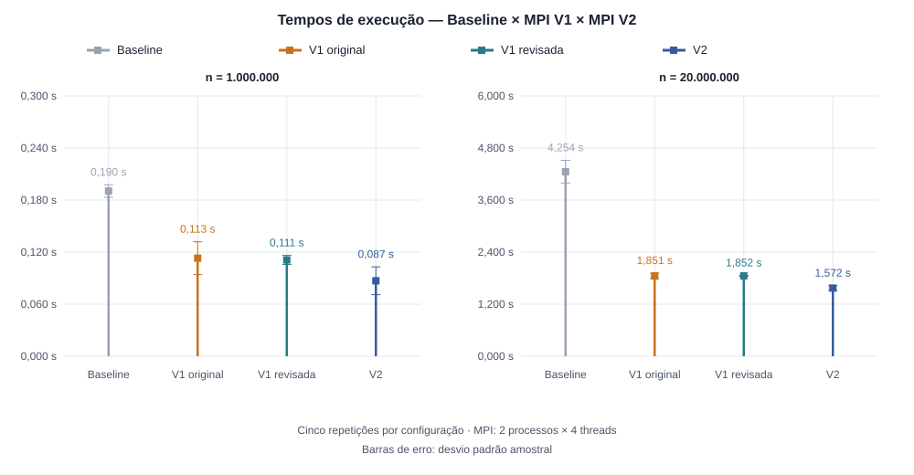
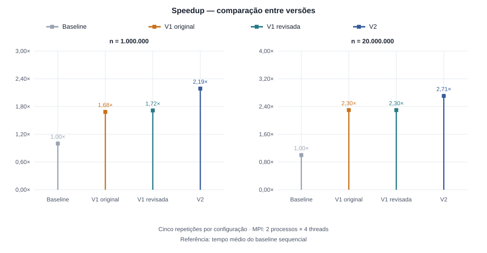
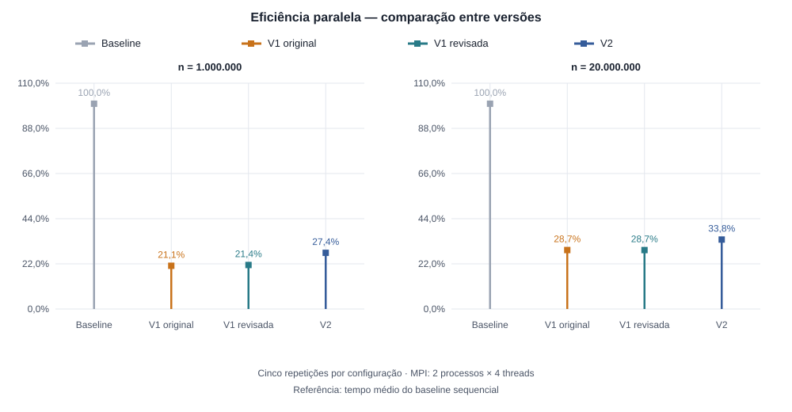
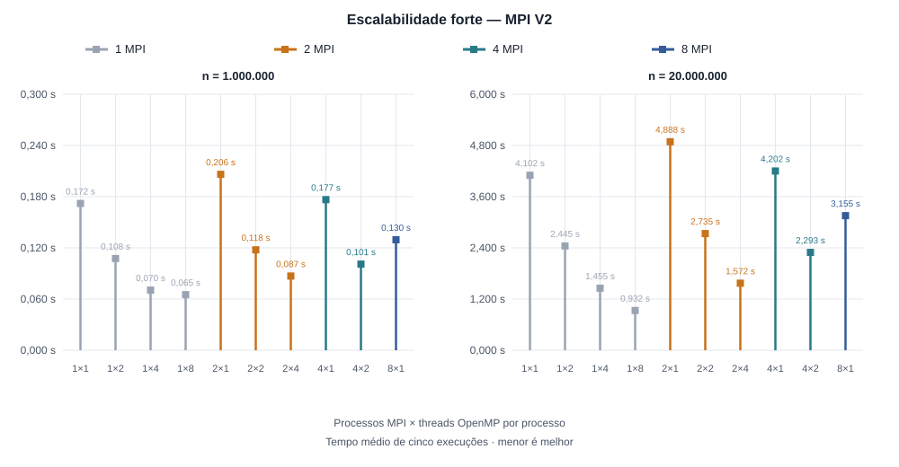
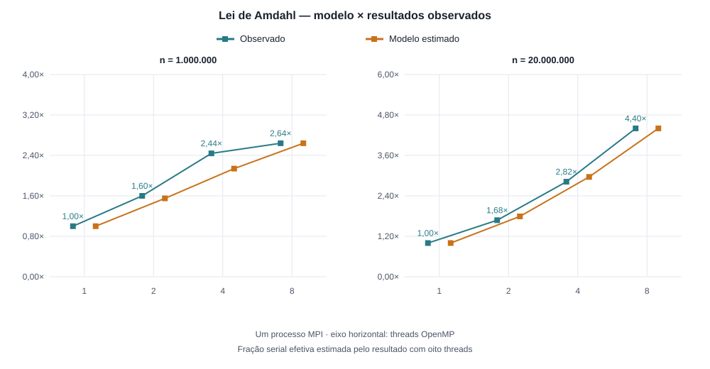
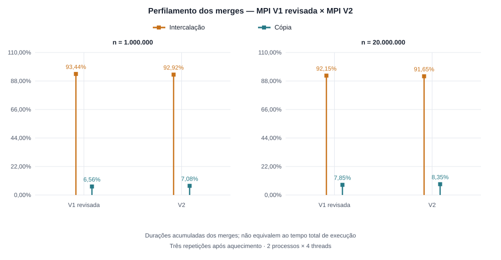
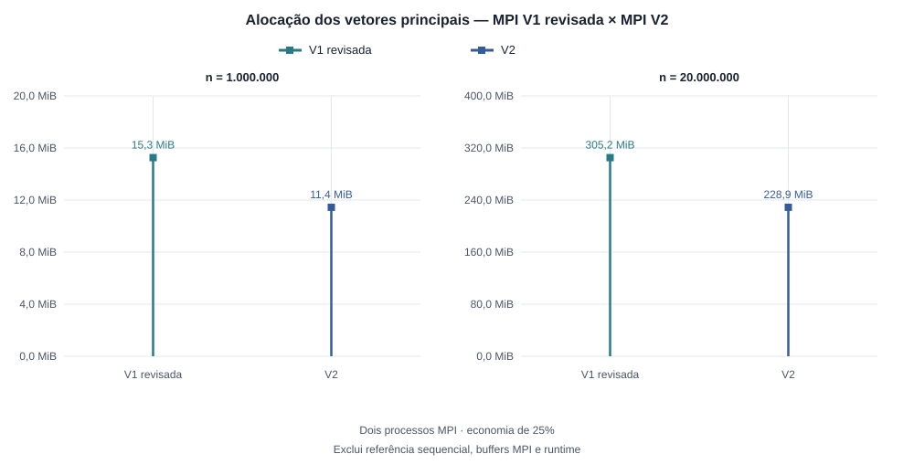
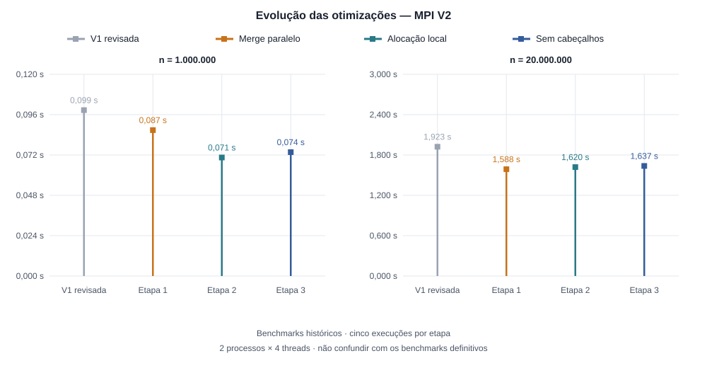

# MPI V2 — Mergesort com MPI + OpenMP

**Disciplina:** Programação Paralela — Baseline 07 (Mergesort)  
**Instituição:** IESB — CCO085 — 2026/2  
**Professor:** Rodrigo Gonçalves Pinto  
**Implementação:** `MPI/v2/mpi.cpp` e `mpiV2perfilamento.cpp`

## 1. Objetivo

Evoluir a MPI V1 revisada mantendo o Mergesort por divisão e conquista e a entrada determinística do baseline. A decomposição recursiva distribui a metade esquerda a outro rank e mantém a direita no rank responsável. A ordenação local usa tarefas OpenMP; os resultados são reunidos por intercalação. O trabalho sequencial de referência é O(n log n), com espaço auxiliar O(n).

## 2. Alterações realizadas

### 2.1. Merge paralelo

A intercalação divide os intervalos ordenados por pivô e busca binária (`lower_bound`/`upper_bound`), preservando a ordem relativa dos empates. As tarefas escrevem em regiões disjuntas do auxiliar; `taskwait` garante a conclusão antes da cópia com `taskloop`. O orçamento de tarefas limita a recursão; os limiares são 2160 para ordenação e 32768 para merge. O merge MPI também utiliza uma região OpenMP. As chamadas MPI ficam fora dessas regiões (`MPI_THREAD_FUNNELED`).

### 2.2. Alocação local

O rank 0 mantém dois vetores de n elementos; cada auxiliar aloca apenas o tamanho do seu subproblema, com índices locais. Para dois ranks, a alocação cai de 4n para 3n inteiros (25%). Considerando int de 4 bytes, são 305,18 para 228,88 MiB em 20 milhões. Não inclui referência, runtime ou buffers MPI.

### 2.3. Distribuição sem cabeçalhos

`calcular_distribuicao_local` reproduz a árvore antes da medição e determina tamanho, processos disponíveis e origem. Cada aresta da árvore usa envio de dados e retorno do resultado, em vez de cabeçalho adicional: 3(p−1) para 2(p−1) mensagens ponto a ponto (−33,33% para p>1). `MPI_Isend` permite ordenar a direita antes de `MPI_Wait`; o recebimento do resultado reutiliza o buffer somente após a espera. A barreira e o broadcast de validação são coletivas e não entram nessa contagem.

### 2.4. Corretude

A V2 normal gera a referência sequencial fora da região cronometrada e compara os vetores integralmente; o status é propagado por `MPI_Bcast`. O perfilador também compara com a referência em ambas as fases. As tarefas de merge escrevem em intervalos disjuntos; o registro compartilhado de níveis usa `omp critical`.

## 3. Ambiente e metodologia

Windows com Docker Compose, 12 CPUs lógicas visíveis, afinidade 0–11, cota cgroup v1 −1, memória 7,61 GiB. Compilação normal `mpicxx -O2 -fopenmp`; perfilamento acrescenta `-g`. O script `benchmarks-v2.ps1` executa 13 configurações por tamanho, cinco repetições, em ordem fixa por rodada (130 registros). Não há aquecimento descartado no benchmark normal; o perfilamento separado usa três repetições e um aquecimento. O tempo normal exclui compilação, inicialização, alocação e validação da V2. Todos os registros têm `ordenado=SIM`, sem duplicatas ou campos ausentes. O status das versões antigas não implica comparação integral.

## 4. Comparação de desempenho

Média, mediana e desvio padrão amostral em segundos. Speedup S = T_baseline/T; eficiência nominal E = S/(p×t). Baseline usa um recurso nominal.

### 1.000.000 elementos

| Versão | Média (s) | Mediana (s) | Desvio (s) | Speedup | Eficiência |

|---|---:|---:|---:|---:|---:|

| Baseline | 0.190399 | 0.189452 | 0.007244 | 1.000 | 100.00% |

| V1 original | 0.113015 | 0.118599 | 0.018926 | 1.685 | 21.06% |

| V1 revisada | 0.110984 | 0.112252 | 0.005157 | 1.716 | 21.44% |

| V2 | 0.086978 | 0.081896 | 0.016030 | 2.189 | 27.36% |

Redução da V2 frente à V1 revisada: 21.63%; frente à original: 23.04%.

### 20.000.000 elementos

| Versão | Média (s) | Mediana (s) | Desvio (s) | Speedup | Eficiência |

|---|---:|---:|---:|---:|---:|

| Baseline | 4.253713 | 4.099371 | 0.261784 | 1.000 | 100.00% |

| V1 original | 1.851138 | 1.836462 | 0.063432 | 2.298 | 28.72% |

| V1 revisada | 1.851891 | 1.851852 | 0.008993 | 2.297 | 28.71% |

| V2 | 1.571574 | 1.565068 | 0.054839 | 2.707 | 33.83% |

Redução da V2 frente à V1 revisada: 15.14%; frente à original: 15.10%.







## 5. Escalabilidade forte

| n | MPI | OpenMP | Média (s) | Mediana (s) | Desvio (s) | Speedup | Eficiência |

|---:|---:|---:|---:|---:|---:|---:|---:|

| 1000000 | 1 | 1 | 0.172011 | 0.176699 | 0.012653 | 1.107 | 110.69% |

| 1000000 | 1 | 2 | 0.107511 | 0.104117 | 0.008476 | 1.771 | 88.55% |

| 1000000 | 1 | 4 | 0.070481 | 0.067768 | 0.007532 | 2.701 | 67.54% |

| 1000000 | 1 | 8 | 0.065143 | 0.059317 | 0.022734 | 2.923 | 36.53% |

| 1000000 | 2 | 1 | 0.206180 | 0.199494 | 0.014204 | 0.923 | 46.17% |

| 1000000 | 2 | 2 | 0.117728 | 0.117012 | 0.001886 | 1.617 | 40.43% |

| 1000000 | 2 | 4 | 0.086978 | 0.081896 | 0.016030 | 2.189 | 27.36% |

| 1000000 | 4 | 1 | 0.176534 | 0.177907 | 0.003428 | 1.079 | 26.96% |

| 1000000 | 4 | 2 | 0.100948 | 0.100645 | 0.003418 | 1.886 | 23.58% |

| 1000000 | 8 | 1 | 0.129503 | 0.129567 | 0.002186 | 1.470 | 18.38% |

| 20000000 | 1 | 1 | 4.102372 | 4.101729 | 0.102523 | 1.037 | 103.69% |

| 20000000 | 1 | 2 | 2.445141 | 2.440913 | 0.034998 | 1.740 | 86.98% |

| 20000000 | 1 | 4 | 1.455123 | 1.472306 | 0.086558 | 2.923 | 73.08% |

| 20000000 | 1 | 8 | 0.932067 | 0.918665 | 0.040819 | 4.564 | 57.05% |

| 20000000 | 2 | 1 | 4.887873 | 4.911419 | 0.139491 | 0.870 | 43.51% |

| 20000000 | 2 | 2 | 2.735284 | 2.705309 | 0.085179 | 1.555 | 38.88% |

| 20000000 | 2 | 4 | 1.571574 | 1.565068 | 0.054839 | 2.707 | 33.83% |

| 20000000 | 4 | 1 | 4.201748 | 4.205655 | 0.086581 | 1.012 | 25.31% |

| 20000000 | 4 | 2 | 2.293384 | 2.248649 | 0.186079 | 1.855 | 23.18% |

| 20000000 | 8 | 1 | 3.155214 | 3.147442 | 0.067831 | 1.348 | 16.85% |



A configuração 1×8 tem menor média nos dois tamanhos. Com oito threads nominais, aumentar ranks piora o tempo observado. Com uma thread por rank, a curva 1, 2, 4, 8 MPI também evidencia ganhos limitados. Comunicação, sincronização, merge e contenção de memória são hipóteses compatíveis com os dados; não há isolamento causal nem teste em cluster.

## 6. Lei de Amdahl

Para separar o efeito OpenMP da distribuição MPI, usa-se V2 1×1 como referência e mantém-se um rank. S(k)=1/[f+(1−f)/k]; f=(1/S(8)−1/8)/(1−1/8).

| n | S(8) | f efetiva | Limite 1/f |

|---:|---:|---:|---:|

| 1000000 | 2.641 | 29.00% | 3.449 |

| 20000000 | 4.401 | 11.68% | 8.561 |



A curva é ajustada ao ponto de oito threads, não uma previsão independente. A fração efetiva inclui overhead e não equivale à fração de código serial medida.

## 7. Perfilamento

Resultados históricos fornecidos no terminal, separados do CSV final. Fase 1 sem coleta interna; fase 2 instrumentada. Ambas retornaram igualdade com baseline.

| n | Versão | Fase 1 | Fase 2 | Intercalação | Cópia | Merge MPI |

|---:|---|---:|---:|---:|---:|---:|

| 1000000 | V1 revisada | 0.098009 | 0.097644 | 0.103049 | 0.007230 | 0.011127 |

| 1000000 | V2 | 0.069549 | 0.059253 | 0.066105 | 0.005034 | 0.002899 |

| 20000000 | V1 revisada | 2.491834 | 2.201395 | 3.317940 | 0.282587 | 0.214718 |

| 20000000 | V2 | 1.574580 | 1.516361 | 2.476121 | 0.225446 | 0.069045 |



A intercalação representa cerca de 93% e 92% das durações acumuladas da V2. O merge MPI caiu aproximadamente 74% e 68% nas rodadas de perfilamento. Merge MPI já integra as métricas por nível; não deve ser somado novamente. Durações acumuladas podem se sobrepor. O campo `maior` representa máximo observado, não média. A fase 2 mais rápida não demonstra aceleração pela instrumentação.

| Operação V2 | 1M (s) | 20M (s) |

|---|---:|---:|

| MPI_Isend | 0.000005 | 0.000006 |

| MPI_Wait | 0.000455 | 0.010687 |

| MPI_Recv resultado | 0.027930 | 0.723756 |

| MPI_Recv dados | 0.028419 | 0.723558 |

| MPI_Send resultado | 0.000346 | 0.007602 |

| Ordenação local (soma) | 0.055547 | 1.429019 |

| Maior média local por rank | 0.027962 | 0.716154 |

`MPI_Recv` inclui espera pelo processamento remoto; não mede transferência pura. O teste adicional n=1.000.001, 3×2, retornou igualdade em ambas as fases (0,078434 e 0,078417 s), com 13,35 MiB de vetores principais.



## 8. Evolução das otimizações

Médias históricas de cinco execuções 2×4, distintas dos benchmarks finais.

| Etapa | 1M (s) | 20M (s) |

|---|---:|---:|

| V1 revisada | 0.098684 | 1.922683 |

| Merge paralelo | 0.086800 | 1.588392 |

| Alocação local | 0.070503 | 1.619845 |

| Sem cabeçalhos | 0.073682 | 1.636961 |



A etapa de merge apresentou redução nos dois tamanhos. A alocação local reduziu memória, mas não demonstrou ganho consistente em 20M. A remoção dos cabeçalhos simplificou a comunicação, sem ganho de tempo demonstrado isoladamente.

## 9. Limitações e conclusão

A V2 supera as versões anteriores na média em 2×4, preservando o resultado exato nos testes V2. A melhor configuração local foi 1×8, sem distribuição efetiva entre ranks. Cinco repetições e ordem fixa não eliminam variação térmica, escalonamento ou efeitos de cache. A eficiência é nominal, não utilização de CPU medida. Não foram coletados tempos de comunicação por rank para toda a matriz, portanto não se pode quantificar o overhead de comunicação em função de p de forma isolada; a curva de tempo/speedup fornece evidência indireta. Os limiares não foram ajustados experimentalmente.

## 10. Reprodução

Na raiz do projeto:

```powershell
powershell -ExecutionPolicy Bypass -File .\benchmarks-v2.ps1 -Repeticoes 5
```

CSV definitivo: `MPI/v2/resultados/benchmarks-finais.csv`. Para perfilamento:

```powershell
$env:N="1000000"
$env:PROCS="2"
$env:THREADS="4"
$env:REPS="3"
$env:AQUEC="1"
$env:CORTE="2160"
docker compose run --rm mpiv2perfilamento
$env:N="20000000"
docker compose run --rm mpiv2perfilamento
```

Os gráficos de comparação usam o CSV definitivo; perfilamento e evolução usam os valores históricos registrados durante o desenvolvimento.
