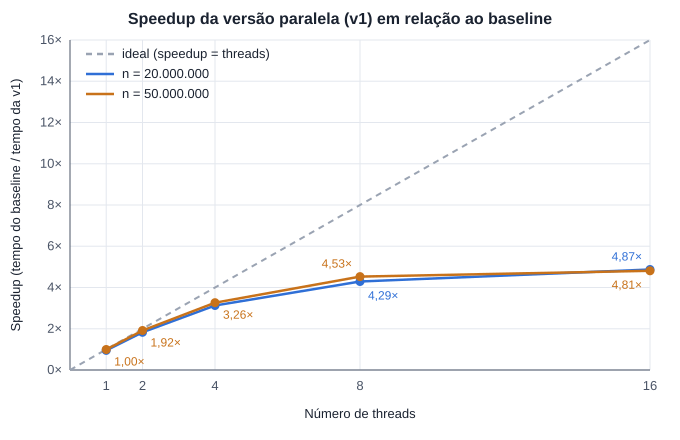

# Qual a ideia
A ideia aqui é paralelizar apenas a recursão do mergesort, sem alterar o código do merge do baseline. Os merges de um mesmo nível são independentes, então podem rodar ao mesmo tempo em threads diferentes.

- `msort_paralelo` divide o trecho ao meio e ordena a metade esquerda numa task enquanto a thread atual ordena a direita. Depois das duas metades prontas, faz o merge com o `merge` do baseline.
- `partes` é quantas threads estão disponíveis para o trecho. Ele é dividido ao meio a cada nível; quando chega a 1, a subárvore é ordenada com o `msort` do baseline, sem criar mais tasks.

# Condições de corrida

**Dados compartilhados na ordenação**

| Dado | Quem escreve | Por que não há condição de corrida |
|---|---|---|
| `a` e `tmp` no `msort_paralelo` | uma task para cada metade | as faixas `[lo, mid)` e `[mid, hi)` não se sobrepõem |
| `a` e `tmp` no merge | a thread que faz o merge | o merge só começa depois que as duas metades terminaram |

A única sincronização necessária é de ordem: o merge só começa depois que as duas metades estão prontas. Isso é feito com `#pragma omp taskwait`. Por isso a ordenação não usa `critical`, `atomic` nem `reduction`: nenhuma posição é escrita por duas threads, e não existe nenhum valor acumulado entre threads.

**critical na instrumentação**

Na versão com perfilamento, todos os merges cronometrados registram o seu tempo na mesma tabela `niveis`, e merges de threads diferentes terminam ao mesmo tempo:

```cpp
#pragma omp critical
{
    registrar(niveis, nivel, hi - lo, t1 - t0, t2 - t1);
}
```

- **Por que critical:** o `registrar` atualiza cinco campos juntos e pode chamar `resize`, que realoca o vetor. O bloco inteiro precisa ser feito por uma thread de cada vez.
- **Por que não atomic:** o atomic protege uma única operação simples sobre uma variável; não cobre o `resize` nem manteria os cinco campos consistentes entre si.
- **Por que não reduction:** os registros acontecem dentro de tasks espalhadas pela recursão, não num laço, e a tabela não é um valor simples a ser somado.

# Medidas
## Protocolo de medição

O mesmo protocolo do perfilamento do baseline, com o programa `openmpV1Perfilamento.cpp`:

- 2 execuções de aquecimento que são descartadas.
- 10 execuções medidas sendo que os valores reportados são as médias dessas execuções.
- Threads: 1, 2, 4, 8 e 16, com `OMP_PROC_BIND=close` e `OMP_PLACES=cores`.
- Tamanhos: 20.000.000 e 50.000.000.
- **Validação:** o resultado de cada fase é comparado, elemento a elemento, com a mesma entrada ordenada pelo `msort` do baseline. Em todas as medições o resultado foi idêntico.

**Fases da medição**

1. **Fase 1 (walltime):** tempo da versão paralela, sem instrumentação. Serve para calcular o speedup.
2. **Fase 2 (onde o tempo é gasto):** a mesma tabela por nível do perfilamento, com o mesmo corte de 2160 elementos.

## Tabela de tempo

**Tempo da Fase 1 por número de threads**

| Threads | n = 20.000.000 (s) | n = 50.000.000 (s) |
|---|---|---|
| 1 | 2,55939 | 6,73517 |
| 2 | 1,32935 | 3,49749 |
| 4 | 0,77598 | 2,05514 |
| 8 | 0,56588 | 1,48132 |
| 16 | 0,49827 | 1,39397 |

Tempo do baseline (tabela do perfilamento): 2,42855 s para n = 20.000.000 e 6,70504 s para n = 50.000.000.

**Onde o tempo é gasto (Fase 2, n = 50.000.000, 8 threads)**

| Nível | Tamanho do trecho | Merges | Sort (s) | Cópia (s) | Total (s) | Maior merge (s) |
|---|---|---|---|---|---|---|
| 0 | 50.000.000 | 1 | 0,2374 | 0,0345 | 0,2719 | 0,2789 |
| 1 | 25.000.000 | 2 | 0,2334 | 0,0297 | 0,2631 | 0,1397 |
| 2 | 12.500.000 | 4 | 0,2321 | 0,0365 | 0,2686 | 0,0770 |
| 3 | 6.250.000 | 8 | 0,2385 | 0,1419 | 0,3804 | 0,0575 |
| 4 | 3.125.000 | 16 | 0,2353 | 0,0972 | 0,3325 | 0,0251 |
| 5 | 1.562.500 | 32 | 0,2337 | 0,0322 | 0,2659 | 0,0124 |
| 6 | 781.250 | 64 | 0,2341 | 0,0191 | 0,2532 | 0,0055 |
| 7 | 390.625 | 128 | 0,2340 | 0,0188 | 0,2527 | 0,0031 |
| 8 | 195.313 | 256 | 0,2343 | 0,0187 | 0,2530 | 0,0027 |
| 9 | 97.657 | 512 | 0,2336 | 0,0189 | 0,2525 | 0,0008 |
| 10 | 48.829 | 1.024 | 0,2333 | 0,0188 | 0,2522 | 0,0003 |
| 11 | 24.415 | 2.048 | 0,2328 | 0,0187 | 0,2515 | 0,0004 |
| 12 | 12.208 | 4.096 | 0,2325 | 0,0186 | 0,2512 | 0,0002 |
| 13 | 6.104 | 8.192 | 0,2327 | 0,0191 | 0,2518 | 0,0002 |
| 14 | 3.052 | 16.384 | 0,2321 | 0,0191 | 0,2512 | 0,0001 |

Os merges dos níveis 0, 1 e 2 continuam sendo feitos por uma thread só cada: o merge da raiz levou 0,2789 s, praticamente o mesmo do baseline (0,2941 s). Do nível 3 para baixo cada subárvore roda numa thread, então os valores são a soma do trabalho das 8 threads.

## Curva de speedup

speedup(p) = tempo do baseline / tempo da versão paralela com p threads

eficiência(p) = speedup(p) / p



| Threads | Speedup 20M | Eficiência 20M | Speedup 50M | Eficiência 50M |
|---|---|---|---|---|
| 1 | 2,42855 / 2,55939 = 0,95× | 95% | 6,70504 / 6,73517 = 1,00× | 100% |
| 2 | 2,42855 / 1,32935 = 1,83× | 91% | 6,70504 / 3,49749 = 1,92× | 96% |
| 4 | 2,42855 / 0,77598 = 3,13× | 78% | 6,70504 / 2,05514 = 3,26× | 82% |
| 8 | 2,42855 / 0,56588 = 4,29× | 54% | 6,70504 / 1,48132 = 4,53× | 57% |
| 16 | 2,42855 / 0,49827 = 4,87× | 30% | 6,70504 / 1,39397 = 4,81× | 30% |

A curva se afasta da linha ideal a partir de 4 threads e praticamente para de subir entre 8 e 16 threads. Isso confirma o que o perfilamento previa: os merges dos níveis de cima continuam sendo feitos por uma thread só, e com mais threads eles passam a dominar o tempo. Para passar desse limite é preciso paralelizar também o merge (v2).
