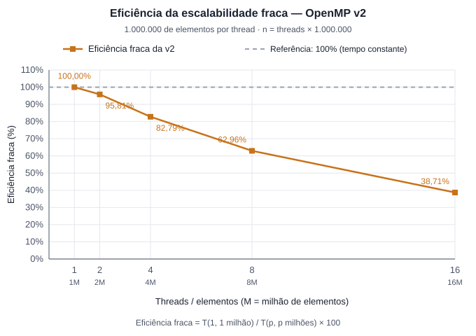

# Análise de desempenho — escalabilidade fraca da OpenMP v2

A análise considera 1.000.000 de elementos por thread. Conforme o número de threads aumenta, o tamanho total do vetor cresce na mesma proporção. O objetivo é observar quanto o tempo de execução varia com esse aumento conjunto de recursos e dados.

| Threads | Elementos | Tempo médio (s) | Eficiência fraca |
|---:|---:|---:|---:|
| 1 | 1.000.000 | 0,076268 | 100,00% |
| 2 | 2.000.000 | 0,079606 | 95,81% |
| 4 | 4.000.000 | 0,092123 | 82,79% |
| 8 | 8.000.000 | 0,121138 | 62,96% |
| 16 | 16.000.000 | 0,197049 | 38,71% |

A eficiência fraca é calculada por `100 × tempo com 1 thread / tempo com p threads`, usando os tamanhos correspondentes da tabela. Quanto mais próximo de 100%, melhor a manutenção do tempo ao aumentar a entrada e a quantidade de threads.

Com duas threads, a v2 processa o dobro de elementos com aumento de apenas 4,38% no tempo. A eficiência de 95,81% indica que, nessa configuração, o paralelismo acompanha bem o crescimento da entrada.

Com quatro threads, o tempo aumenta 20,79% em relação à execução com uma thread, e a eficiência cai para 82,79%. Com oito threads, o aumento chega a 58,83%, com eficiência de 62,96%. O programa consegue processar mais dados por segundo, mas precisa de mais tempo para concluir a entrada proporcionalmente maior.

A maior perda ocorre na passagem de oito para dezesseis threads: o volume de dados dobra, enquanto o tempo aumenta aproximadamente 62,67%. Com dezesseis threads, a execução leva 2,58 vezes o tempo inicial para processar dezesseis vezes mais elementos. Isso representa uma vazão aproximadamente 6,19 vezes maior que a configuração com uma thread, apesar da eficiência fraca de apenas 38,71%.

Parte do crescimento do tempo é compatível com a natureza do Merge Sort, cujo trabalho cresce como `n log n`. Manter a quantidade de elementos por thread constante não mantém o trabalho por thread exatamente constante. Pelo modelo `n log₂(n)`, passar de um milhão para dezesseis milhões de elementos aumenta o trabalho médio por thread em aproximadamente 20,1%. Esse crescimento, por si só, não explica todo o aumento de tempo observado.

A v2 distribui tanto a ordenação quanto a intercalação entre tarefas, mas ainda precisa sincronizar essas tarefas e ler e escrever os vetores a cada nível da ordenação. Custos de gerenciamento, acesso à memória e compartilhamento de recursos entre threads podem contribuir para a redução dos ganhos. A configuração de dezesseis threads também utiliza threads lógicas sobre oito núcleos físicos no ambiente registrado. Os tempos disponíveis não permitem separar a contribuição de cada fator.

Os resultados mostram boa escalabilidade fraca com duas threads e perda progressiva de eficiência nas configurações seguintes. A vazão continua aumentando até dezesseis threads, mas o ganho adicional diminui, especialmente depois de oito threads. Como os dados apresentam apenas médias, sem medidas de dispersão, essa análise descreve a tendência observada nesta rodada.
