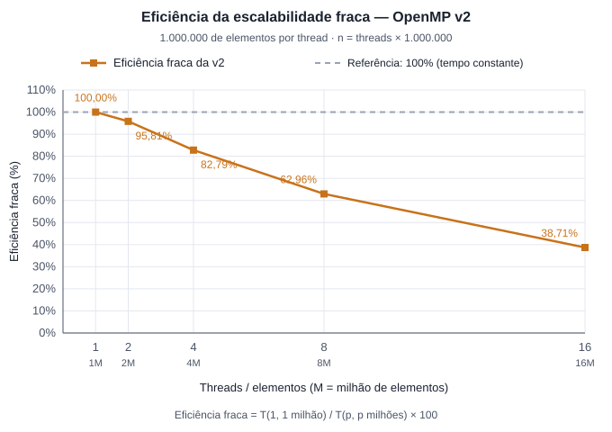

# Qual a ideia
A ideia aqui é alterar especificamente o código do merge para que ele também possa ser paralelizado. Dessa forma a gente pode aumentar um pouco a fração paralelizavel do código.

- `msort_paralelo` divide o trecho ao meio e ordena a metade esquerda numa task enquanto a thread atual ordena a direita. Quando acabam as threads disponíveis (`partes = 1`), a subárvore é ordenada com o `msort` do baseline.
- `merge_paralelo` divide o merge em pedaços independentes: o pivô (meio da metade maior) e uma busca binária na outra metade separam os elementos por valor, e cada pedaço escreve na sua própria faixa de `tmp`. Depois, a cópia de `tmp` para `a` é dividida entre as threads com `taskloop`.

# Condições de corrida

**Dados compartilhados na ordenação**

| Dado | Quem escreve | Por que não há condição de corrida |
|---|---|---|
| `a` e `tmp` no `msort_paralelo` | uma task para cada metade | as faixas `[lo, mid)` e `[mid, hi)` não se sobrepõem |
| `tmp` no merge paralelo | cada pedaço do merge | cada pedaço escreve numa faixa diferente de `tmp` |
| `a` durante a intercalação | ninguém | os pedaços só leem `a` |
| `a` na cópia de volta | cada task do `taskloop` | cada task copia um intervalo diferente |

A única sincronização necessária é de ordem: o merge só começa depois que as duas metades estão prontas, e a cópia só depois que a intercalação terminou. Isso é feito com `#pragma omp taskwait`. Por isso a ordenação não usa `critical`, `atomic` nem `reduction`: nenhuma posição é escrita por duas threads, e não existe nenhum valor acumulado entre threads.

**critical na instrumentação**

Na versão com perfilamento, todos os merges cronometrados registram o seu tempo na mesma tabela `niveis`, e merges de threads diferentes terminam ao mesmo tempo:

```cpp
#pragma omp critical
{
    registrar(niveis, nivel, hi - lo, t1 - t0, t2 - t1);
}
```

- **Por que critical:** o `registrar` atualiza cinco campos juntos e pode chamar `resize`, que realoca o vetor. O bloco inteiro precisa ser feito por uma thread de cada vez.
- **Por que não atomic:** o atomic protege uma única operação simples sobre uma variável; não cobre o `resize` nem manteria os cinco campos consistentes entre si.
- **Por que não reduction:** os registros acontecem dentro de tasks espalhadas pela recursão, não num laço, e a tabela não é um valor simples a ser somado.

# Medidas
## Protocolo de medição

O mesmo protocolo do perfilamento do baseline, com o programa `openmpV2Perfilamento.cpp`:

- 2 execuções de aquecimento que são descartadas.
- 10 execuções medidas sendo que os valores reportados são as médias dessas execuções.
- Threads: 1, 2, 4, 8 e 16, com `OMP_PROC_BIND=close` e `OMP_PLACES=cores`.
- Tamanhos: 20.000.000 e 50.000.000.
- **Validação:** o resultado de cada fase é comparado, elemento a elemento, com a mesma entrada ordenada pelo `msort` do baseline. Em todas as medições o resultado foi idêntico.

**Fases da medição**

1. **Fase 1 (walltime):** tempo da versão paralela, sem instrumentação. Serve para calcular o speedup.
2. **Fase 2 (onde o tempo é gasto):** a mesma tabela por nível do perfilamento, com o mesmo corte de 2160 elementos.

## Tabela de tempo

**Tempo da Fase 1 por número de threads**

| Threads | n = 20.000.000 (s) | n = 50.000.000 (s) |
|---|---|---|
| 1 | 2,47263 | 6,58975 |
| 2 | 1,25090 | 3,31091 |
| 4 | 0,64233 | 1,72408 |
| 8 | 0,38072 | 1,01334 |
| 16 | 0,30923 | 0,78109 |

Tempo do baseline (tabela do perfilamento): 2,42855 s para n = 20.000.000 e 6,70504 s para n = 50.000.000.

**Onde o tempo é gasto (Fase 2, n = 50.000.000, 8 threads)**

| Nível | Tamanho do trecho | Merges | Sort (s) | Cópia (s) | Total (s) | Maior merge (s) |
|---|---|---|---|---|---|---|
| 0 | 50.000.000 | 1 | 0,0314 | 0,0272 | 0,0586 | 0,0654 |
| 1 | 25.000.000 | 2 | 0,0600 | 0,0262 | 0,0862 | 0,0516 |
| 2 | 12.500.000 | 4 | 0,1181 | 0,0371 | 0,1552 | 0,0434 |
| 3 | 6.250.000 | 8 | 0,2536 | 0,1662 | 0,4197 | 0,0593 |
| 4 | 3.125.000 | 16 | 0,2411 | 0,1192 | 0,3603 | 0,0290 |
| 5 | 1.562.500 | 32 | 0,2381 | 0,0322 | 0,2703 | 0,0109 |
| 6 | 781.250 | 64 | 0,2379 | 0,0191 | 0,2569 | 0,0052 |
| 7 | 390.625 | 128 | 0,2384 | 0,0185 | 0,2569 | 0,0026 |
| 8 | 195.313 | 256 | 0,2383 | 0,0186 | 0,2570 | 0,0013 |
| 9 | 97.657 | 512 | 0,2379 | 0,0188 | 0,2566 | 0,0007 |
| 10 | 48.829 | 1.024 | 0,2373 | 0,0184 | 0,2557 | 0,0003 |
| 11 | 24.415 | 2.048 | 0,2369 | 0,0182 | 0,2551 | 0,0002 |
| 12 | 12.208 | 4.096 | 0,2367 | 0,0182 | 0,2550 | 0,0002 |
| 13 | 6.104 | 8.192 | 0,2368 | 0,0186 | 0,2554 | 0,0002 |
| 14 | 3.052 | 16.384 | 0,2365 | 0,0187 | 0,2551 | 0,0001 |

## Análise de escalabilidade forte

O tamanho do vetor permanece fixo enquanto aumentamos as threads. O speedup é `tempo do baseline / tempo paralelo`, e a eficiência é `100 × speedup / threads`.

| Threads | Speedup 20M | Eficiência 20M | Speedup 50M | Eficiência 50M |
|---:|---:|---:|---:|---:|
| 1 | 0,98× | 98,22% | 1,02× | 101,75% |
| 2 | 1,94× | 97,07% | 2,03× | 101,26% |
| 4 | 3,78× | 94,52% | 3,89× | 97,23% |
| 8 | 6,38× | 79,74% | 6,62× | 82,71% |
| 16 | 7,85× | 49,08% | 8,58× | 53,65% |

A v2 apresenta ganhos próximos do ideal até quatro threads. Com oito, ainda mantém eficiência próxima de 80%. Dezesseis threads produzem os menores tempos, mas dobrar de oito para dezesseis reduz o tempo em apenas 18,78% para 20M e 22,92% para 50M.

A paralelização do merge melhora o desempenho em relação à v1: para 50M e dezesseis threads, o tempo cai de 1,39397 s para 0,78109 s, uma redução de 43,97%. Tarefas, sincronização e acesso à memória podem limitar os ganhos seguintes, mas as médias disponíveis não isolam essas causas.

As eficiências ligeiramente acima de 100% decorrem da comparação com o baseline medido separadamente; não comprovam ganho superlinear. Os valores são das medições já registradas, sem uma nova rodada de testes.

## Análise de escalabilidade fraca

A entrada cresce junto com a quantidade de threads, mantendo 1.000.000 de elementos por thread. A eficiência fraca é `100 × tempo com 1 thread / tempo com p threads`, considerando a entrada correspondente a cada configuração.

| Threads | Elementos | Tempo médio (s) | Eficiência fraca |
|---:|---:|---:|---:|
| 1 | 1.000.000 | 0,076268 | 100,00% |
| 2 | 2.000.000 | 0,079606 | 95,81% |
| 4 | 4.000.000 | 0,092123 | 82,79% |
| 8 | 8.000.000 | 0,121138 | 62,96% |
| 16 | 16.000.000 | 0,197049 | 38,71% |



Com duas threads, o volume dobra e o tempo aumenta apenas 4,38%, indicando boa escalabilidade. A eficiência diminui nas configurações seguintes: chega a 62,96% com oito threads e a 38,71% com dezesseis. Na última configuração, o programa processa dezesseis vezes mais elementos em aproximadamente 2,58 vezes o tempo inicial.

Manter elementos por thread constantes não mantém exatamente o trabalho por thread, pois o Merge Sort tem custo `n log n`. Tarefas, sincronização, memória e o uso de threads lógicas também podem contribuir para o aumento do tempo, mas as médias registradas não isolam essas causas. O desempenho melhora em volume processado por segundo, porém não mantém o tempo constante ao ampliar a entrada.
